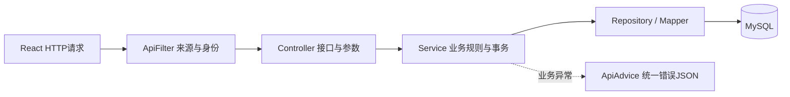
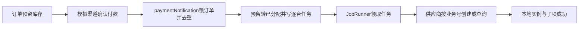

# Java 业务代码阅读指南

P1 新增优惠券、发票、知识发布、账号找回、自动续费和辅助办理等领域，入口与验收见 [P1 本地交付说明](P1-本地交付与验收.md)。下文的交易主流程仍适用于当前分层代码。

这份指南对应 `business-java` 的当前源码。源码包含中文类职责、方法说明和关键业务注释，并已按三层架构重构；完整约定见 [Java三层架构与开发规范](Java三层架构与开发规范.md)。这里按照请求执行顺序解释；不要求先把所有 Spring 注解背下来。

## 1. 先区分三个进程

| 部分 | 负责什么 | 本地端口 |
|---|---|---|
| React | 页面、表单、按钮、显示接口结果 | 5173 |
| Java | 登录权限、商品、订单、库存、支付、资源、售后和AI网关 | 5000 |
| Python | 模型调用、Agent编排、RAG、工具选择、会话记忆 | 5001 |

Java 不负责生成模型答案；Python 不负责决定用户能否退款、库存是否足够、订单能否变成已付款。即使模型“说支付成功”，Java也只认可受控渠道结果。

普通请求的路径是：



**Controller 找到该由谁处理，Service 判断该不该做、应该怎样做，数据库层实际读写数据。** Controller 不再访问数据库；分页通过 `ListQueryService → ListRepository` 完成。Service 负责规则与事务，Repository 负责 SQL 和数据访问。

## 2. 目录与类的分工

| 文件或分组 | 阅读重点 |
|---|---|
| `BusinessApplication.java` | 程序从哪里启动，哪些组件由Spring创建 |
| `web/ApiFilter.java` | 请求到控制器前，如何确定当前用户 |
| `controller/AuthController.java`、`service/AuthService.java` | 注册、登录、Cookie、令牌、退出与改密 |
| `entity/PlatformUser.java`、`PlatformProduct.java` | Java字段如何映射数据库列 |
| `mapper/PlatformUserMapper.java`、`PlatformProductMapper.java` | MyBatis-Plus通用CRUD接口 |
| `repository/SqlExecutor.java`、`common/JsonCodec.java`、`common/Values.java`、`service/BusinessEvents.java` | 数据库执行、JSON、值转换和审计/通知分开管理 |
| `service/CatalogService.java` | 商品筛选、SKU约束、整数分计价、价格版本 |
| `service/TradeService.java` | 报价、幂等下单、预留库存、关单和付款确认 |
| `job/JobRunner.java`、`service/JobService.java` | 任务领取、事务、重试、开通、续费、到期和退款 |
| `service/ResourceService.java` | 资源操作提交、退款预览、额度锁定、运营审核 |
| `service/SupportService.java` | 工单、回复、分派、受保护附件 |
| `controller/AdminController.java`、`service/AdminService.java` | 后台接口、运营/管理员权限 |
| `service/InternalIdentity.java`、`controller/InternalController.java`、`service/InternalToolService.java` | 服务身份、用户委托和受控AI查询 |
| `controller/ChatController.java`、`service/ChatService.java`、`integration/AgentClient.java` | Java怎样代理Python的SSE并保存本人会话 |
| `integration/*Adapter.java` | 外部渠道/资源的接口与模拟实现 |
| `bootstrap/SchemaMigration.java` | 初始化时的增量迁移、校验和演示数据 |
| `common/ApiError.java`、`web/ApiAdvice.java` | 业务异常怎样变成HTTP错误响应 |

`service/BusinessService.java`、`entity/CloudOrder.java`、`CloudInstance.java`及旧Mapper是早期查询代码。当前 `/internal/tools/*` 由 `InternalController` 处理，不经过旧 `BusinessService.execute`。**Spring把一个类注册成Service，不等于每个请求都会调用它。**

新交易数据在 `p0_*` 表中；旧 `cloud_orders/cloud_instances` 保留作历史数据。不要把这两套表当成同一条交易链路。

## 3. 结合Python理解常见Java写法

```java
private final TradeRepository repository;

public TradeService(TradeRepository repository /* 其余依赖省略 */) {
    this.repository = repository;
}
```

这是构造器保存依赖的简化展示。实际源码中的时间参数还带 `@Value`，从配置中获取。

- `this.repository` 类似Python的 `self.repository`；右边的 `repository` 是构造器参数。
- `private` 表示只能在本类中直接使用；`public` 允许外部访问。
- `final` 表示这个字段赋值后不能改为另一个引用，**不代表它引用的对象内部绝对不可变**。
- Spring发现 `@Service` 后创建对象，并把已有的 `TradeRepository` 等对象传入，这叫依赖注入。业务代码通常不手动 `new TradeService(...)`。
- 默认这些组件是容器中的单例。不能把“当前用户”保存成共享字段供所有请求读写；本项目把Actor放在当前请求属性中。
- `static` 方法属于类，例如 `Values.id()`；普通方法属于对象，例如 `trade.createOrder(...)`。
- `import static ...Values.*` 让本文件可以直接写 `id()`、`now()`，并没有在此文件重新定义这些函数。

```java
Map<String, Object> order;
List<Map<String, Object>> items;
var config = json.parse(order.get("config"));
```

`Map` 接近Python字典，`List` 接近列表；泛型说明元素类型。`Object` 表示值可以是不同Java类型，所以取金额时还要按 `Number` 处理。`var` 是编译器推断局部变量类型，**不是把Java变成动态类型语言**。

`Map.of(...)` 创建不可修改的Map，不能包含null键值；`new LinkedHashMap<>(sku)` 创建可修改的浅拷贝。当前SKU行主要是字符串、数值等标量，但不能据此把浅拷贝当成深拷贝。

```java
public record Actor(String id, String role, String sessionId) {}
```

`record` 是简洁的数据载体写法，会提供 `id()`、`role()` 等访问器。`a.id()`取得认证用户编号；它不是数据库查询，也不是Python字典下标。

## 4. 项目中的注解分别做什么

| 注解 | 当前项目的用途 |
|---|---|
| `@SpringBootApplication` | 标记应用入口并启用组件扫描、自动配置等 |
| `@MapperScan` | 让MyBatis注册指定包中的Mapper代理 |
| `@EnableScheduling` | 启用定时调用，供JobRunner轮询 |
| `@Component`、`@Service` | 把对象交给Spring管理；Service表达业务服务角色 |
| `@RestController` | 方法返回值通常序列化为HTTP响应体 |
| `@GetMapping`、`@PostMapping` | 根据请求方法和路径选择接口方法 |
| `@PathVariable` | 读取 `/orders/{id}` 里的id |
| `@RequestParam` | 读取 `?page=1`，或multipart中的file部分 |
| `@RequestBody` | 把JSON请求体转成Java对象/Map |
| `@RequestHeader`、`@CookieValue` | 读取HTTP头或Cookie |
| `@Value` | 从配置读取端口、服务地址或期限等值 |
| `@Transactional` | 通过Spring代理进入方法时应用数据库事务规则 |
| `@Scheduled` | 按配置周期调用轮询方法，不等于给每台实例创建线程 |
| `@RestControllerAdvice`、`@ExceptionHandler` | 统一处理控制器异常并生成错误响应 |
| `@TableName`、`@TableField`、`@TableId` | 指定MyBatis-Plus表、列、主键映射 |
| `@JsonIgnore` | 密码哈希不出现在JSON输出中，不影响数据库存储 |
| `@Select`、`@Param` | 自定义MyBatis查询及SQL参数名绑定 |

注解提供框架需要的元信息。它们不会代替所有业务代码：有 `@RestController` 不代表自动鉴权，有 `@Transactional` 也不代表已经写对库存和退款规则。

## 5. 从登录请求看完整执行过程

1. React发送 `POST /api/auth/login`，JSON里是用户名、密码。
2. `ApiFilter`把登录列为公开入口，因此不要求用户先有访问令牌；仍做来源检查。
3. `AuthController.login`取JSON和来源IP，调用 `AuthService.login`。
4. Service检查15分钟失败窗口，再用BCrypt验证密码。不存在的用户名也执行一次虚拟密码校验，减少明显耗时差。
5. 成功时 `newSession`创建访问/刷新/CSRF令牌。数据库保存的是令牌哈希，不是明文令牌。
6. Controller把刷新令牌写入HttpOnly Cookie，从JSON移除刷新原值，再返回访问令牌。
7. React后续请求带 `Authorization: Bearer ...`。`ApiFilter`调用 `authenticate`验证会话，再将Actor放到请求属性。

这里的访问令牌不是JWT，**不能把它Base64解码后直接读出用户身份**。Java每次按哈希查询数据库，因此退出、改密或停用后的会话能被拒绝。

认证和归属校验不同：认证说明“你是谁”，`TradeService.owned`说明“这张订单是不是你的”。后台还多一层角色检查。

## 6. 重点阅读createOrder：事务、锁和幂等各管什么

入口：`PlatformController.order` → `TradeService.createOrder`。

前端只提交报价编号及请求头幂等键。金额、配置和用户身份不由前端决定。

执行顺序：

1. 验证幂等键格式，取得报价编号及其请求摘要。
2. `SELECT ... FROM p0_users ... FOR UPDATE` 锁定当前用户行，串行检查同用户配额与重复提交。
3. 同键同报价返回原订单；同键不同报价抛409冲突。
4. 检查本人报价、有效期、当前可售状态和配置；SKU/产品锁防止检查期间被上下架修改。
5. 计算当前活动、待支付和待履约实例数量，避免利用异步开通绕过账号配额。
6. 使用带条件的UPDATE预留库存。
7. 写订单、逐台子项、outbox事件及审计，再提交事务。

关键SQL：

```sql
UPDATE p0_skus
SET reserved = reserved + ?
WHERE id = ?
  AND capacity - reserved - allocated >= ?
  AND active = TRUE
```

`repository.reserveStock(...) == 1`说明满足条件并更新了一行，Repository内部返回`s.run`的影响行数；0表示没有预留成功。不能先查出“剩余1台”，再让两个请求各自无条件扣1台。

三个概念不要混用：

- **事务**：订单、库存、子项等本地数据库改动一起成功或回滚。
- **锁/条件更新**：让并发请求不能基于同一旧状态完成互相冲突的修改。
- **幂等**：同一个业务请求重试，不新增另一张订单或重复执行同一业务效果。

`@Transactional` 默认主要针对运行时异常和Error回滚；普通受检异常并非一律自动回滚。当前 `ApiError` 是运行时异常。

事务注解还依赖代理调用：`AuthService.login`内部直接调用 `newSession`，不会因为后者带注解就另开事务；`refresh`本身经过代理进入事务后，内部 `newSession`则使用已经存在的事务。**判断事务范围要看实际调用路径。**

## 7. 付款成功为什么还不直接得到实例



前端 `simulate`只更新模拟渠道台账。付款事实由核验回调或 `reconcilePayments`的主动查询交给交易服务处理。

`paymentNotification`与取消/关单竞争同一订单行锁：

- 正常成功：保存付款事实、转换库存、写逐台任务。
- 重复同一成功流水：返回已有结果，不再创建一组任务。
- 取消/关闭后才收到成功付款：保存晚到付款事实，进入异常售后处理，不直接开通。

当前实现把付款确认和履约入队放在一个事务，订单直接呈现 `FULFILLING`，不会先单独提交一版 `PAID`。支付单和支付事件保留成功付款事实。

`allocated`表示已付款占用容量，包含等待开通、失败待处理等子项；不是只统计RUNNING主机。

## 8. JobRunner和JobService怎样执行后台任务

`JobRunner.poll`只定时调用 `JobService.poll`；业务处理和显式事务在JobService，SQL在JobRepository，每次要处理什么从数据库读取。它依次处理关单、支付补偿、到期扫描、outbox及资源任务。

`claim`用一段事务完成领取：

```text
找 next_run 已到的 PENDING / RUNNING
→ FOR UPDATE 锁住任务
→ 写 RUNNING 和未来60秒租约
→ 提交
```

`process`再用一段事务执行实际本地变更并标成功。失败时，执行事务先回滚，然后另开一段事务记录失败次数、退避时间和错误。否则“失败次数+1”也可能被一起回滚，任务会永远像第一次执行。

这里用 `TransactionTemplate`明确控制事务块；`execute`的lambda会同步执行，**不会因为是lambda就自动异步运行**。按当前轮询路径，它们分别形成事务；模板本身仍有事务传播规则，不能泛化为任何时候都强制新事务。

超过重试上限进入 `MANUAL_REQUIRED`，管理员带原因重试。退款中的子项不能再次开通。

供应商适配器的 `REQUIRES_NEW`与这几段事务不同：通过注入的Spring代理调用时，模拟供应商台账独立提交。这样可复现：

```text
供应商已经创建成功 → Java本地提交前中断
→ 重启后重新领取任务 → 按原业务号查到已有供应商资源
→ 补齐本地记录，而不是再创建一台
```

这套代码依赖任务状态、数据库唯一键、稳定业务号及模拟供应商幂等共同恢复，不宣称任何外部系统都具备“一次且仅一次”的神奇保证。

## 9. 资源操作、续费和退款的关键区别

**启动/停止/重启/释放**：`ResourceService.action`验证本人、状态、冲突业务和幂等键，递增 `op_version`，写操作中状态并创建任务；`JobService.action`再次检查版本、确认供应商结果后更新最终状态。停止不等于暂停计费或延长租期。

**续费**：先报价和付款，再由后台延长期限。未到期以原期限为起点；已到期但在宽限期内，以恢复处理时刻起算。到期任务携带旧期限，执行时发现当前期限已变，就不能继续按旧期限停机/释放。

**退款**：预览 → 提交并占额度 → 运营审核 → 资源处理 → 渠道退款 → 结清额度。申请成功和审核通过，都不等于渠道退款已经成功。

`ResourceService.refundable`按订单快照计算，而不是查当前商品价格：

- 失败履约项或允许的晚到付款取消项：按子项实付额度处理。
- 允许期限内的新购成功项：按剩余秒数比例计算，向下取整到分。
- 已履约续费或已续费资源的复杂退订：当前交给工单，不自动承诺可退。

提交时还要检查 `refunded_cents + refund_held_cents + 本次金额 <= total_cents`。如果不考虑处理中占用额，两份并发申请可能分别认为还有足够余额。

## 10. AI网关中的两层身份

`ChatService`先确认登录和会话归属，再把服务器取得的用户编号交给Python。浏览器JSON中的 `user_id`不覆盖Actor。

Python回调Java工具时带：

| 凭据 | 回答的问题 |
|---|---|
| `X-Service-Token` | 是否是获准内部服务发起调用 |
| `X-User-Context` | 这次代表哪个用户、哪个登录/聊天会话，是否还有效 |

签名上下文只是Base64URL编码加HMAC，不是加密。Java验证签名/过期时间，再查数据库登录会话是否已撤销或停用，因此不能只持服务令牌就随意指定用户。

`ChatService.chat`返回与HTTP框架无关的 `ChatStream`回调，`ChatController`把它转换为 `StreamingResponseBody`并设置SSE响应头；`AgentClient`负责连接Python：

- `reader`读取Python的输入流，`out`写浏览器的输出流。
- 每行都转发，包括SSE分隔事件用的空行，再flush。
- `content`用于累计存档，`done`用于识别正常结束；只有部分存档不等于模型完整回答。
- try-with-resources 类似Python的 `with`，负责关闭读取器和关联流。
- 请求号先复制成局部变量，不能假定异步写回调还在原HTTP线程上读取MDC。

Java这里代理流，不等于Java自己实现了模型逐token生成。Python实际何时产出内容，还要看Python的流式实现。

## 11. SQL参数绑定和Mapper不要混淆

```java
// Repository 内部才执行具体 SQL
s.one("SELECT * FROM p0_orders WHERE id=? AND user_id=?", id, user);
```

这里是JDBC的 `?`，后面的参数交给驱动绑定。MyBatis自定义SQL中的 `#{userId}`也是绑定参数，但属于另一套语法。MySQL/PyMySQL练习中的 `%s`不能直接原样搬到这段Java里。

动态表名不能用 `?`代替。`TradeRepository.findOwned`和 `ListRepository.page`拼表名之前必须先从固定白名单选择；排序字段也是这样。**不是所有字符串拼接都自动危险，也不是用了参数绑定就能允许任意表名。**

`BaseMapper<PlatformUser>`提供通用实体CRUD；它不会自动替你处理库存扣减、跨表退款、幂等键和业务权限。当前实现为这些操作在Repository中写了专门的参数化SQL。Mapper也经Repository封装，不直接暴露给Controller。

旧 `MetricsMapper.aggregate`有一个容易看错的地方：CPU和内存取AVG，网络取MAX。旧响应把它们装在 `metrics_7d_avg`里，不代表每个字段都是七天均值；源码注释已明确标出。

## 12. 建议在IDEA里的阅读顺序

1. 打开 `PlatformController`，找到一个熟悉接口，例如 `/api/orders`。
2. 定位 `trade.createOrder(...)` 的方法定义，顺着调用看完一条请求。
3. 看到 `repository.reserveStock`等方法，跳到TradeRepository，再看SqlExecutor怎样绑定参数。
4. 看到 `task(...)`再去JobService；JobRunner只负责定时触发，JobRepository负责数据访问。
5. 最后对照 `tests/p0_acceptance.py`等本地验收脚本，理解预期行为与边界。它们是教师实现/验证证据，不代表你已经能独立实现同样系统。

构建包含 ArchitectureTest 分层约束与Service测试；交易回归使用本地模拟环境验收脚本，测试记录保留在数据库中。Python Agent与模型协议保持原有接口。

## 13. 商品查询的 Redis 缓存

阅读 CatalogService.products/product/regions，再看 integration/CatalogCache.read：缓存命中返回 JSON，未命中才执行传入的 Repository 查询。skus/available 和交易流程仍实时查 MySQL。商品或 SKU 修改由 Service 注册 afterCommit 回调，提交后切换 Redis 版本；回滚不执行。配置、降级和测试见 [Redis业务缓存](Redis业务缓存.md)。

## 14. 平台实例池与应用部署

先读ApplicationController → ApplicationService → ApplicationRepository，再读PoolService/PoolRepository和PoolResourceAdapter。TradeService在订单事务中预留具体池实例；原JobService通过适配器完成交付与资源操作。物理资产ID与每次租约的业务交付ID不同，避免第二次出租触发旧表唯一约束。

应用执行走RunnerController和独立deployment-runner/runner.py。计划确认、租约和generation由Java验证；Runner只执行批准的模板，SQLite保存外部执行回执。JobService遇到POOL_ACTION_PENDING时在当前事务提交Runner任务并延期原任务，不把执行意图随异常回滚，也不消耗失败重试次数。

ApplicationSecretVault只负责加密与本地密钥文件；Service负责密钥归属、配置版本和执行时下发。Python DeploymentAgentNode只能准备计划，不能调用网页确认接口。普通页面与聊天使用同一套Java权限和业务规则。

运行入口、验证证据和外部边界见[应用部署平台交付说明](应用部署平台-本地交付与验收.md)。
