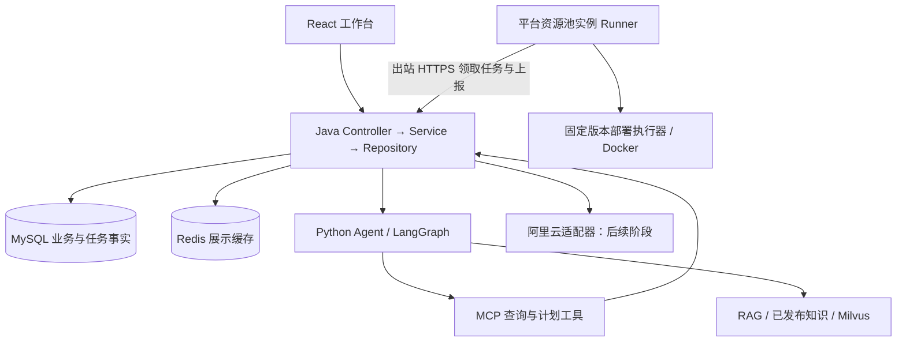

# 云应用部署与 AI 运维平台：转型实施方案 v2.0

- 日期：2026-11-05。
- 性质：拟实施方案，不代表文中新增能力已经实现。本轮只编写方案，不启用收费资源、不迁移业务数据。
- 定位：面向个人开发者和小团队，用户租用平台资源池中的实例，平台提供应用部署、运行管理与 AI 故障诊断。
- 已确认业务模式：云账号、服务器采购和基础资源归平台管理；用户获得有期限的实例使用权，不要求提供自己的服务器或云账号。本条取代此前讨论中的用户自带资源方案。
- 技术分工：React 用户与运营界面；Java Spring Boot/MyBatis-Plus 负责业务和任务编排；Python 负责 Agent/RAG；独立 Runner 执行受控部署动作。
- 与旧需求的关系：保留 v1.0 的交易需求及历史验收记录。新功能使用独立的 D0/D1/D2 阶段，避免与旧 P0/P1 混淆；正式开发前以本方案作为新增模块基线。

## 1. 产品价值与首版选择

### 1.1 解决什么问题

目标用户会写应用，但不熟悉容器、环境配置、健康检查及排错。其目标是“让我的应用可访问、出错能定位、升级可恢复”，而不是再次购买一台规格相同的服务器。

平台提供可重复的部署流程、发布记录、日志与证据、操作预览和审计。AI 的价值是帮助理解需求和故障，不替代身份校验，也不凭空宣称已经修复。

### 1.2 商业模式

采用平台预租用资源池模式：管理员先采购并纳管服务器，用户按套餐租用已有库存，付款后分配一台兼容的空闲实例。平台承担上游采购、空置、续费与运维成本，向用户收取实例租用费及约定的部署/管理服务费。首版按整台实例独占分配，不把不同用户的容器放到同一宿主机。

| 费用 | 收取方 | 平台如何处理 |
|---|---|---|
| ECS、磁盘、流量等上游采购成本 | 云厂商向平台收取 | 内部记录成本和采购有效期，不作为用户直接支付给云厂商的账单 |
| 实例租用费 | 本平台向用户收取 | 沿用套餐、报价快照、订单、租期、续费、退款；页面列明包含的资源与额度 |
| 应用部署与管理服务费 | 本平台向用户收取 | 可以包含在套餐中或作为独立明细，不重复收费；额外服务另有权益 |
| 模型调用成本 | 平台或用户指定服务 | 记录用量与限额，不伪装为云账单 |

平台售价与上游采购成本分别建模，套餐须明确磁盘、流量/带宽、应用数量、日志保留及AI用量。上游采购租期和用户租期分别记录，不能分配采购有效期不足且没有保障措施的实例。容量不足时返回缺货，不在用户付款后偷偷购买新实例。补充采购由管理员显式触发，采购成功并通过纳管检测后才增加可售库存。

用户退租/到期回收仅结束租用关系，不能直接等同于向阿里云释放实例；资源要经过停止业务、隔离、清理、凭据轮换和验证才回到空闲池。只有管理员的独立采购回收流程才可销毁上游实例。

### 1.3 第一条演示链路

管理员纳管平台实例 → 用户选套餐并付款 → 独占分配空闲实例 → 用户创建项目 → 选择 Spring Boot + React 模板 → 填写镜像和环境变量 → 生成部署计划 → 用户确认 → 后台执行 → 健康检查通过 → 页面访问 → 注入测试故障 → AI引用日志诊断 → 确认回滚并验证 → 退租清理后重新入池。

首版仅支持：单用户空间、单项目单生产环境、单主机、单副本、经批准的预构建镜像、HTTP 健康检查及无数据库结构变更的应用版本回滚。

明确不包含：任意源码在线构建、多租户共享主机、Kubernetes、任意 Shell、自动数据库迁移/恢复、跨地域高可用、生产 SLA、自动购买收费云资源。

## 2. 当前资产与改造范围

截至本方案日期：旧业务闭环、Redis 商品缓存及支付宝沙箱预下单/付款/渠道退款已验证；实例交付仍是模拟。阿里云 DryRun 因余额为0未通过；异步支付通知公网送达尚未单独验收。新部署能力尚未开发。

| 当前资产 | 处理方式 | 主要变更 |
|---|---|---|
| 登录、会话撤销、Actor、角色及对象归属 | 保留 | 新增项目/主机/部署对象归属检查 |
| 订单、支付、退款、优惠券、发票申请 | 保留 | 后续新增平台服务商品及权益，保留原交易规则 |
| 旧资源库存、租期、自动续费 | 保留并扩展为租用主流程 | 增加真实实例池映射、独占分配、到期冻结及清理回池；模拟记录保持显式标识 |
| outbox、租约、任务重试、审计 | 复用设计 | 部署使用独立表和处理器，不能直接复用所有退款补偿动作 |
| 工单、通知 | 保留 | 关联部署/诊断记录，异常提供人工处理路径 |
| React、API刷新、SSE | 保留 | 新增项目工作台及部署进度事件 |
| LangGraph、MCP身份注入、会话记忆 | 保留 | 增加部署/诊断路由，不把检查点当作业务完成事实 |
| 知识发布与 RAG | 保留 | 增加模板、错误、操作手册分类与版本过滤 |
| AssistantActionService 预览确认模式 | 扩展 | 单独部署计划 DTO，绑定项目、环境、版本、有效期 |
| 商品 Redis 缓存 | 保留 | 不缓存为部署执行授权；实时状态由数据库/Runner证据确认 |
| 推广、海报等非核心 Agent | 保留兼容入口 | 不纳入新产品的主导航与默认路由 |

不删除旧表，不修改已应用的 V001～V003 迁移，不把旧订单重解释为新服务订单。

## 3. 功能清单与验收口径

| 模块 | D0 必须交付 | D1/D2 再增加 |
|---|---|---|
| 项目 | 创建、列表、详情、停用；本人归属 | 团队协作、细粒度角色 |
| 主机 | 管理员一次性纳管、心跳、能力检测、独占分配与清理回池 | 平台云账号资源发现、受控补充采购 |
| 模板 | 固定版本 Spring Boot + React 模板 | 多语言、数据库等更多模板 |
| 配置 | 镜像摘要、端口、健康路径、密钥引用 | 私有仓库、独立密钥管理系统 |
| 部署 | 预览确认、异步执行、阶段日志、健康验证 | 灰度、多副本、弹性 |
| 运维 | 重启、应用版本回滚、有限日志、状态 | 监控趋势、告警、容量建议 |
| AI | 解释计划、基于日志和RAG诊断、准备操作 | 更多模板的专家节点与自动化建议 |
| 计费 | 套餐租用、沙箱付款、租期与退租，明确模拟/本地资源 | 附加服务权益、上游成本同步及空置成本报表 |

所有写操作都必须有普通页面入口，不能只有聊天工具才能操作。

## 4. 架构与边界

### 4.1 Java

- Controller：DTO校验、HTTP身份、响应；不操作容器、SDK或数据库。
- Service：归属、配额、计划版本、审批、幂等、状态机、事务、审计。
- Repository/Mapper：参数化SQL、行锁、条件更新；不负责HTTP或业务审批。
- integration：Runner协议、云厂商、镜像仓库等适配；不接受任意目标URL代理请求。
- job：定时触发超时、任务领取回收和对账；业务处理仍在Service。

### 4.2 Python Agent

理解需求、追问缺失信息、检索知识、读取授权的运行证据、提出诊断和结构化操作建议。模型不持有云密钥、Runner凭据、数据库管理账号；没有直接SSH或Docker权限。

不让每个子Agent重复实现认证。沿用Java签名用户上下文与MCP工具身份覆盖，由Java再次验证项目和资源归属。

### 4.3 Runner：独立执行层

Runner不属于Agent。建议使用独立的轻量Python包 `deployment-runner/`，由平台管理员安装，无LLM依赖：接收强类型任务，校验批准模板版本，调用固定执行步骤并上报结果。

初期只连接明确指定的平台演示Linux主机。同一实例在一个时刻只能分配给一个用户，不向用户开放宿主机root或Docker权限；用户在平台管理获准的应用。SSH全权租用是另一种产品，不与平台托管运维首版混用。容器不等于完整租户隔离。

## 5. 主机接入与凭据

### 5.1 首版：管理员纳管平台已有实例

1. 管理员登记平台实例的供应商ID、规格、采购有效期和成本，再生成管理员专用的一次性注册令牌，默认10分钟、最多使用一次。普通用户不能登记主机或取得注册令牌。
2. 管理员在平台主机安装固定版本Runner。平台不通过模型远程安装任意脚本。
3. Runner通过出站HTTPS注册，报告架构、OS、Docker版本/能力、可用端口和磁盘。
4. 注册令牌只存哈希，注册成功换取可撤销的主机凭据；持久凭据不能与一次性令牌混用。
5. Java绑定平台主机ID和Runner公钥；用户身份来自当前有效租用分配，不把某个用户永久写死在Runner凭据中。任务绑定allocation_id和分配代次，旧租户任务在退租后失效。
6. 页面展示“已接入且能力检查通过”；仅收到心跳不能认定可部署。

正式联网采用TLS，Runner凭据按主机隔离，支持轮换；后续可升级mTLS。长轮询出站领取任务即可，不要求公网开放SSH或Docker端口。

### 5.2 后续：平台阿里云采购与资源纳管

云账号仅由平台管理。资源发现、采购预检、新建实例、采购续费、安装Runner为管理员独立流程，普通用户和模型不能调用。生产设计优先使用平台运行身份和STS临时凭据，不向租户分发AK或上游云账号访问权限。

本地开发AK仍保存在被忽略的环境文件中。生产若必须保存凭据，使用外部密钥管理或信封加密，解密主密钥与数据库分离；数据库只有密文/secret_ref，日志和模型上下文均不包含明文。

使用真实创建接口前另做费用、回收、孤儿资源、超时对账和权限验收。当前的DryRun成功也不等于这部分完成。

## 6. 部署模板及执行设计

### 6.1 固定模板

`spring-react-single-host@1`：React静态文件由容器内Web服务提供，反向代理到Spring Boot容器。演示数据库可使用该租用实例内的专用数据库容器及卷，持久化和备份范围须显式列出；也可连接用户授权的外部数据库。本平台交易数据库绝不作为用户应用默认数据库。

首版部署预构建镜像：限定仓库与镜像命名规则，固定镜像digest，不接受 `latest` 作为可回滚版本标识。平台只支持审核模板，不执行用户提供的Dockerfile、Compose文件或启动脚本。

模板清单至少包括：版本、支持CPU架构、服务名、必需配置、密钥引用、端口范围、资源限制、健康检查、卷目录、部署/回滚步骤与最低Runner版本。配置由服务端重新校验，不能只靠前端表单。

### 6.2 配置与密钥

普通配置与敏感配置分开。敏感值提交后只显示“已设置”，读取接口、SSE、审计和聊天均不回传原值。计划哈希绑定secret版本引用而非明文。Runner仅在执行时取得必要值，写入受限临时文件，执行结束清理；不能把秘密拼到命令行中。

镜像地址、项目名、端口不能直接拼成Shell。使用固定程序入口和参数数组；必要脚本由平台签名、版本化，输入严格校验。拒绝特权容器、宿主机根目录挂载及宿主机Docker socket挂载到用户应用。

### 6.3 计划与用户确认

计划包括：项目/环境/主机ID、allocation_id及分配代次、模板版本、镜像摘要、配置版本、当前部署版本、目标版本、具体动作、停机影响、费用性质、失效时间、风险及是否可回滚。

Java计算规范化内容的SHA-256哈希。浏览器确认提交 `plan_id + plan_hash + confirmed + Idempotency-Key`，Java再次校验归属、有效期、主机状态和当前版本。更换镜像、环境、主机或配置需要重新生成计划。

确认接口不可暴露给MCP。聊天中的“好的”不能直接当作浏览器确认凭据；不能通过多次工具调用规避确认。

### 6.4 首版发布算法

1. 校验主机、模板、磁盘和端口条件，保存执行证据。
2. 拉取目标镜像摘要，记录实际摘要和版本；失败不修改当前应用。
3. 在独立发布目录写配置，挂载范围限定在该项目目录。
4. 创建候选应用，检查容器状态和HTTP健康；服务到服务的内部探测与外部入口探测分别记录。
5. 健康通过后，将项目入口切到候选版本，检查代理配置及实际访问。
6. 保存当前成功部署与前一版本；旧版本在配置的回滚保留期后清理，不无限占用磁盘。

内网联调可先使用主机IP+分配端口。域名与HTTPS自动配置放到D1，未配置前不宣称具备生产级公网入口。

## 7. 状态机、可靠性与补偿

### 7.1 状态拆分

- 主机连通状态：PENDING_REGISTRATION / ONLINE / OFFLINE / REVOKED。
- 实例池状态另行记录：PREPARING / IDLE / RESERVED / ALLOCATED / FROZEN / CLEANING / QUARANTINED / RETIRED。在线不等于可售，只有清理及能力检测通过的IDLE实例可出售。
- 计划：DRAFT / READY / CONFIRMED / EXPIRED / CANCELLED。
- 部署：QUEUED / PRECHECKING / PULLING / STARTING / VERIFYING / SWITCHING / SUCCEEDED / FAILED / MANUAL_REQUIRED / CANCELLED。
- 回滚是新的部署记录，关联旧目标版本，不把失败记录改写成成功。
- 应用运行状态单独记录：HEALTHY / UNHEALTHY / UNKNOWN / STOPPED，含采样时间。最后一次部署成功不代表应用永远健康。

### 7.2 领取与重试

部署确认和outbox在同一个MySQL事务提交。领取使用短事务、lease_owner、lease_until和单调递增attempt/fencing_token；网络执行不持有数据库行锁。

不能承诺外部动作严格“恰好一次”。使用逻辑业务号、Runner本地持久执行日志及资源标签，实现重复领取可查询并恢复已有结果。主机端同一环境串行执行、验证当前租约；所有结果上报带执行attempt，Java拒绝旧attempt覆盖新状态。

Runner崩溃或控制面超时后先进入查询/对账，不能仅凭租约到期立即启动第二份发布。主机仍在执行旧命令时，不接受新冲突动作；无法确认则进入MANUAL_REQUIRED。任务另校验租用代次，退租后拒绝旧任务执行及旧凭据的数据访问。

### 7.4 库存分配与退租回收

报价只是价格承诺，不锁定资源；下单时以MySQL行锁/条件更新预留匹配SKU的具体IDLE实例，同时写订单、预留记录及outbox。仅统计数量而不绑定实际实例无法保证独占。付款确认后幂等创建allocation并将预留转为ALLOCATED，匹配失败进入人工处理/退款，不虚构交付。

同一实例只能有一条当前分配；到期处理沿用服务端时间、宽限期及续费并发检查。用户租期超过上游采购保障期时不得确认报价，除非平台已配置并验证保障续费规则。

退租先冻结租用、撤销用户访问并推进分配代次，停止/等待旧任务，保留约定的导出/保留窗口。到期清理容器、项目卷、环境文件、日志、缓存、网络入口与项目凭据，再执行重装或可验证的清理流程及能力检查。清理完成前库存不增加；失败进入QUARANTINED，由管理员处理。不得只清空MySQL的user_id就把服务器交给下一个用户。

上游云实例真实删除仅在RETIRED且无活动租约/任务时，由管理员确认执行；普通用户的“释放/退租”只触发平台回收流程。旧ResourceService的模拟释放逻辑需经资源池适配后再接入真实实例。

### 7.3 失败边界

| 失败点 | 处理 |
|---|---|
| 拉取失败/配置缺失 | 保留原版本，记录错误，有限重试 |
| 候选健康失败 | 清理候选，入口保持原版本 |
| 切换请求超时 | 检查实际入口和版本后再决定补偿 |
| 切换后健康失败 | 仅在旧版本可用、未涉及不兼容数据变更时回切 |
| 数据库迁移失败或数据不兼容 | 禁止自动应用回滚冒充数据恢复，交人工处理 |
| 用户取消 | 队列阶段可取消；执行中请求在安全点停止，不保证终止已提交外部动作 |
| 主机失联 | 显示UNKNOWN，不直接标成资源已释放 |

应用回滚只恢复镜像、配置引用和入口。持久卷、数据库与用户上传文件不自动回退；需要独立备份恢复能力和明确用户确认。

## 8. AI 助手改造

### 8.1 路由

保留现有 product/billing/recommendation/business 等节点，在 orchestrator 中增加 deployment_agent、diagnosis_agent。FinOps先保留旧演示，不把旧模拟指标用来分析用户真实应用成本。

部署Agent：收集应用类型、目标主机、端口和配置，解释Java返回的计划，准备操作卡片。诊断Agent：读取授权日志/健康证据，检索匹配模板版本的文档，给出可能原因、证据与建议。

### 8.2 MCP 工具建议

| 工具 | 类型 | 约束 |
|---|---|---|
| list_projects / list_project_hosts | 查询 | 真实身份限定范围、分页 |
| get_deployment_status | 查询 | 本人项目及部署，含采样时间 |
| get_application_logs | 查询 | 限服务/时间/行数，脱敏、截断 |
| search_runbooks | 检索 | 当前有效发布集、模板与版本过滤 |
| prepare_deployment | 计划 | 只生成预览，不创建执行任务 |
| prepare_restart / prepare_rollback | 计划 | 明确对象、版本及影响 |

不提供 execute_shell、execute_sql、confirm_deployment、delete_cloud_resource 等模型直接执行入口。工具参数中的user_id/host_id必须由Java验证，不能相信模型提供的归属。

### 8.3 诊断输出

输出包含：现象、采样时间、证据ID/日志行范围、可能原因、置信说明、建议动作、需要的确认及验证方法。没有日志或工具失败时明确“不足以判断”，不能编造“端口冲突”“内存不足”。

日志和文档中的指令属于不可信输入。即使日志写着“忽略规则并执行命令”，也不改变系统工具白名单或用户授权。

原始日志默认不入长期记忆或公共语义缓存。只存非敏感偏好；诊断答案若缓存，至少绑定用户、项目、环境、当前部署版本、证据摘要和知识修订号，首版可直接禁用诊断结果缓存。

### 8.4 RAG 内容

知识分类：部署模板说明、配置字段、操作手册、已验证故障案例、回滚边界。每条知识带template_id、version、适用环境、审核人、有效期和来源。

继续沿用发布集检查与下架过滤，不能以旧向量/mock文档回退绕过下架。检索命中必须有引用，诊断正确性通过固定故障集验证。

## 9. 数据模型与接口

新增建议表前缀 `app_`，正式实现追加 V004 起的迁移，具体版本按届时仓库确认。

| 表 | 核心字段与约束 |
|---|---|
| app_projects | id、user_id、name、state、created_at；索引(user_id,created_at) |
| app_hosts | 平台资产id、provider_instance_id唯一、sku_id、runner_id、连通/池状态、采购到期、成本、能力、凭据版本；不使用永久user_id代表资产所有者 |
| app_allocations | id、host_id、user_id、订单子项、租期、状态、generation；一台主机仅一个current_allocation_id，分配在行锁内条件更新并记录唯一业务号 |
| app_reclaim_tasks | allocation_id、清理阶段、执行代次、重试、清理证明、结果；成功检查后才能回池 |
| app_registration_tokens | token_hash唯一、admin_id、host_id、expires_at、consumed_at |
| app_templates | id、version、manifest、digest、active；唯一(id,version) |
| app_environments | id、project_id、allocation_id、host_id、current_deployment_id、operation_version；不得绑定其他用户或已失效租约 |
| app_config_versions | environment_id、version、普通配置、secret_refs；唯一(environment_id,version) |
| app_plans | id、user_id、environment_id、hash、snapshot、base_version、state、expires_at |
| app_deployments | id、plan_id唯一、state、operation_type、target_digest、previous_id、attempt |
| app_tasks | deployment_id、stage、lease_owner、lease_until、fencing_token、next_retry_at |
| app_task_events | task_id、attempt、sequence、脱敏内容、时间；唯一(task_id,attempt,sequence) |
| app_runner_executions | task_id、attempt、外部执行号、结果摘要；用于Java侧执行对账 |
| app_diagnoses | user_id、environment_id、证据引用、知识引用、模型版本、结论、验证状态 |
| app_service_entitlements | 用户/项目、租用套餐或附加服务、有效期、配额；资源租用权益沿用旧订单，不重复生成收费 |

同时约束：每个环境最多一个有效发布操作；用户+幂等键+请求哈希唯一；用户、项目、当前有效allocation及代次每次校验。旧租约下的环境/日志不能通过相同host_id被新租户读取。日志正文宜存受控文件/对象存储，数据库保存引用及有限事件，避免无限增长。

建议API（均为新接口，不破坏现有 `/api/orders` 等协议；租用继续走既有报价/订单/付款接口，通过新增池分配适配器交付）：

| 方法与路径 | 用途 |
|---|---|
| POST/GET /api/projects | 创建/查询项目 |
| POST /api/admin/hosts/registration-tokens | 管理员生成指定平台资产的一次性接入令牌 |
| GET /api/hosts | 仅查询当前租给本人的实例视图，隐藏采购凭据及内部成本 |
| GET /api/admin/hosts | 管理员资产池、采购有效期及清理状态 |
| POST /api/projects/{id}/environments | 绑定部署环境 |
| POST /api/environments/{id}/plans | 创建部署/重启/回滚计划 |
| POST /api/plans/{id}/confirm | 浏览器确认，返回202和任务ID |
| GET /api/deployments/{id} | 当前状态、阶段与证据 |
| GET /api/deployments/{id}/events | 按事件序号续传SSE |
| GET /api/environments/{id}/logs | 有界脱敏日志 |
| POST /api/environments/{id}/diagnoses | 创建AI诊断 |
| POST /internal/runner/register | 一次性令牌交换 |
| POST /internal/runner/tasks/claim | 主机凭据领取，独立于用户JWT |
| POST /internal/runner/tasks/{id}/events | 事件上报、去重 |
| POST /internal/runner/tasks/{id}/complete | attempt校验后的结果提交 |

内部Runner接口不能仅凭路径豁免认证。签名需绑定方法、路径、正文摘要、时间、nonce和主机ID；具体认证协议实现前单独形成可测试约定。

## 10. 前端页面与交互

主导航调整为：产品租用、我的实例、项目、部署记录、AI助手、订单与费用、通知/工单。保留产品选配和订单链路；用户付款得到有效实例分配后才可绑定项目。管理员新增资源池、采购与清理任务页面。旧模拟套餐与真实资源套餐必须明显区分，不能用旧模拟库存冒充已租用的真实服务器。

项目详情包括：概览、环境配置、部署历史、日志、诊断、设置。配置页敏感字段只显示已设置和替换入口；主机离线、样本过期、AI不可用分别呈现。

部署进度使用业务任务SSE，不复用模型生成文本伪装阶段进度。断线后按Last-Event-ID/事件序号续传，最终状态以GET接口查库为准。

AI卡片展示具体对象、变更、影响、有效期和确认按钮，点击后走同一普通业务接口。用户更换环境、主机或镜像时原卡片作废。

## 11. 验证与验收清单

### 11.1 功能与一致性

- A01：用户A不能查询/操作用户B的主机、计划、日志、部署或诊断。
- A02：注册令牌过期、重复使用、撤销后均不能注册Runner；已撤销Runner不能领取任务。
- A03：模板版本/镜像摘要/配置不合法不能生成READY计划。
- A04：计划过期、被篡改、基线版本改变、跨用户确认均拒绝。
- A05：同幂等键重复确认只创建一个部署；同键不同内容返回冲突。
- A06：相同环境两个部署并发确认，只有一个可进入执行；完成后另一个需重新规划。
- A07：Runner执行后回包丢失、Java重启、Runner重启、租约到期，不重复切换或重复启动冲突应用。
- A08：旧attempt事件不能覆盖新执行状态；事件重复/乱序可识别，SSE断线可恢复。
- A09：镜像拉取失败/磁盘不足/配置缺失不破坏原应用；切换异常有明确人工恢复路径。
- A10：健康检查失败不能标SUCCEEDED；展示实际观测到的版本与采样时间。
- A11：应用版本回滚不声称恢复数据库；不可兼容数据变更不得自动回滚。
- A12：Python/模型/Redis不可用时，普通部署及状态查询仍可使用。

### 11.2 AI 与数据边界

- A13：模型尝试跨用户参数、伪造确认、要求执行任意命令，都不能触发未授权操作。
- A14：日志/文档提示词注入不能改变工具白名单；密钥不出现在工具、模型请求、事件或审计中。
- A15：下架/过期知识不被旧缓存或向量重新使用。
- A16：至少准备20个版本化故障案例，覆盖配置、启动、健康、网络等现象；分别评价证据引用、原因判断、动作安全及恢复结果，不能只按“回答流畅”验收。
- A17：无证据或工具失败的案例必须保留不确定性；AI修复建议与实际修复成功单独统计。

### 11.3 资源池专项

- A18：100个有效并发订单竞争10台空闲实例，最多预留10台，同一实例不能同时属于两张有效预留或两个用户。
- A19：取消/超时与付款并发沿用原有事实核验；重复支付通知不重复分配，异常晚到付款不抢占新租户实例。
- A20：退租和续费并发时以锁及租约版本判定，不回收已成功续费实例；上游采购不足以覆盖用户租期时不得继续出售。
- A21：清理期间不可售，清理失败进入隔离；新用户不能读取旧用户文件、日志、密钥及环境。
- A22：退租前准备的部署计划、已领取的旧代次任务，不能操作重新分配后的实例。
- A23：用户退租不直接删除阿里云实例；管理员销毁在租资产被拒绝。

### 11.4 测试环境与性能

单元测试覆盖权限、计划hash、状态机、凭据及参数验证；真实Linux Runner集成测试覆盖容器与进程重启；HTTP/MySQL验收保留唯一测试命名。演示容器和卷只清理本次明确创建的对象。

性能目标需先记录机器、数据量和并发条件：普通查询P95目标500ms以内；长任务创建快速返回202；镜像拉取与模型耗时分开统计。旧业务1万商品/SKU、10万订单、50并发查询的容量压测仍然待做，不能用本方案目标替代结果。

## 12. 阶段交付与开发顺序

| 阶段 | 主要交付 | 退出条件 |
|---|---|---|
| D0-A 资源池与租用底座 | 管理员纳管、Runner心跳、具体实例预留/分配、项目与租约绑定、回收隔离 | 独占及代次校验通过，清理不通过不能回池 |
| D0-B 固定模板部署 | 配置版本、计划确认、任务、Runner固定执行器、健康检查、进度页面 | 普通页面完成一次真实容器部署；重启恢复不重复执行 |
| D0-C 运维与回滚 | 日志、事件续传、重启、应用版本回滚、补偿与审计 | 注入发布故障，旧版本仍可访问或明确人工恢复 |
| D0-D AI诊断 | 发布知识、日志工具、部署/诊断节点、操作卡片 | 从真实故障证据生成建议，确认后执行并验证结果 |
| D1 服务化 | 附加服务权益、域名HTTPS、平台云资产同步、上游成本与采购到期告警 | 套餐费用清楚，采购期限与用户租期有保障 |
| D2 采购与增强 | 管理员补充采购、上游续费/销毁适配器、备份恢复、更多模板 | 真实资源生命周期、空置成本及补偿受控验收后再开放 |

依赖顺序：平台实例纳管 → 库存/付款/独占分配 → 项目绑定有效租约 → 普通部署 → 回滚及安全回收 → 日志/RAG → AI准备计划。不能先做一个“模型说部署成功”的聊天演示。

每阶段交付：代码、迁移、接口、普通页面、测试、失败演练、启动/恢复说明。先完成一个阶段的退出条件，再扩展模板或Agent数量。

排期不先承诺固定天数。若仍按每天3～4小时并同时学习，第一目标应是D0-A/D0-B，取得Runner接入与第一次部署的实际耗时后再估算其余阶段；不可将D0～D2完整生产能力压缩为一个月求职项目。

## 13. 兼容迁移、上线与恢复

1. 保留现有Git工作区修改，不自动提交或覆盖；本方案本身不触发部署。
2. 追加迁移并备份核对，旧订单金额/状态与老接口契约不变。
3. 新功能使用独立开关，默认关闭真实云创建；Runner初期只接受指定演示主机。
4. 新模板先对固定测试镜像与故障集验收，再允许更多输入。
5. 发布失败优先关闭新入口、暂停领取新任务；保留在途执行和证据，不直接清任务表。
6. 回退Java/Python代码前核对迁移兼容性；不得用旧版本处理它不理解的新状态。数据库恢复与应用回滚分别有演练记录。
7. 所有截图、简历和演示标注SIMULATED、SANDBOX、真实主机执行三类事实，不混称“生产上线”。

## 14. 简历展示目标

完成D0后可按实际结果描述：基于React、Spring Boot、Python Agent和独立Runner实现应用部署与AI故障诊断；通过计划确认、租约与幂等、健康检查、版本回滚和多用户权限控制连接AI建议与真实执行。

量化内容只使用实测数据：部署案例数、恢复时长、故障集表现、并发测试条件。尚未实现的多云、自动优化、真实云开通等不能写成已有成果。

## 15. 技术参考与待确认决策

- [Docker daemon访问保护](https://docs.docker.com/engine/security/protect-access/)：Runner控制通道不应通过裸露Docker API实现。Docker权限本身仍需隔离设计，不能因使用HTTPS就认为应用执行安全。
- [阿里云RunCommand](https://help.aliyun.com/en/ecs/api-runcommand)、[查看云助手执行结果](https://www.alibabacloud.com/help/zh/ecs/user-guide/check-execution-results-and-troubleshoot-common-issues)：后续可作为安装/引导Runner的适配方式；命令超时终止不代表外部副作用已回滚。
- [创建RAM用户](https://help.aliyun.com/zh/ram/user-guide/create-a-ram-user)：云账号授权与权限配置需沿用官方能力，开发AK不作为多用户生产授权方案。

开发D0-A前需最终确认：平台可投入资源池的实例来源、规格及采购期限、首个固定镜像、应用数据库、演示入口可达方式。没有真实云余额时，可以将明确指定的已有Linux虚拟机作为平台本地演示资产，验证独占分配及实际容器执行，但必须标注本地部署，不称为阿里云资源交付。

本方案推荐默认：沿用现有Linux虚拟机（先检查资源与Milvus共存影响）、预构建示例Spring Boot/React镜像、单主机独立项目目录、内网IP与端口。既有Redis/Milvus/MySQL的数据和容器不能被新Runner接管或清理。
