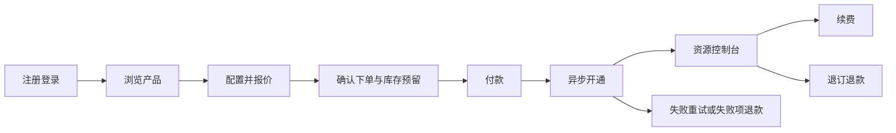

# 云服务租用平台需求规格说明书 v1.0

- 日期：2026-11-03
- 定位：具备独立交易与资源管理能力的云服务平台，内置 AI 助手；不是只有聊天入口的智能客服。
- 文档性质：拟实施需求基线，不代表以下能力已经开发完成。
- 技术分工：React + TypeScript 用户端与管理端；Java Spring Boot + MyBatis-Plus 业务服务；Python Agent 服务。
- 需求优先级：P0 为首版业务闭环必须完成；P1 为完整运营版本；P2 为后续增强。

实施与验收记录见 [P0 交付说明](P0-交付与验收.md)。本文件保留需求基线，实际已验证范围以交付说明和测试报告为准。

## 1. 目标与当前差距

用户无需通过聊天，也能注册登录、浏览产品、选配报价、租用下单、支付、查看订单和资源、续费及发起售后。管理员可维护商品、价格、库存和业务规则，并处理异常订单和退款。

AI 助手作为业务增强入口，提供知识问答、选型建议、订单及资源查询和辅助办理；任何业务写入仍由 Java 校验和执行。

当前代码已经具备 Java/Python 服务分层、部分订单与实例查询、产品目录、推广物料、Agent/RAG/记忆等基础。尚不具备完整登录鉴权、商品运营、创建订单、支付、资源履约及售后闭环。已有模型工具返回业务数据，不等于具备对应的用户页面和业务操作接口。

此前独立的设备借还、项目故障排查等方向文档，不作为本次云服务平台的需求基线。

## 2. 首版假设与范围

### 2.1 首版基线

1. 面向个人用户的单平台、多用户系统；暂不引入企业组织、子账号及多租户企业账本。
2. 首版完整履约对象为 ECS 云服务器，支持规格、地域、镜像、系统盘、带宽及租期选择。RDS、GPU、独立云盘可以展示为不同产品类型，但未实现开通适配器的类型必须明确标为不可购买。
3. P0 支持包月/包年预付费；按量付费、抢占式实例列为 P2。不能用固定套餐交易冒充实时计量计费。
4. 金额统一为人民币，后端及数据库使用整数分；折扣采用定点数和明确舍入规则，禁止使用浮点数参与结算。
5. 本地交付提供模拟支付渠道和模拟资源供应商，完整执行交易、异步任务、库存及状态流程；页面明确标识“模拟支付/模拟实例”。不能把模拟实例标成可实际登录的云主机。
6. 支付与资源供应商均抽象为适配器。真实渠道凭据、云厂商、地域及账号由后续接入配置决定，业务核心不直接依赖厂商 SDK。
7. 服务端时间统一存储为 UTC，展示使用 Asia/Shanghai；到期判断全部使用服务端时间。

### 2.2 P0 范围

注册登录、用户中心、公开产品列表与详情、SKU 与价格、报价、库存预留、下单支付、异步开通、订单与资源控制台、手动续费、退订退款申请、基础工单、管理后台、通知、操作审计，以及基于真实登录身份的 AI 查询。

### 2.3 P1/P2 范围

- P1：真实支付/真实资源适配器、更多产品类型、优惠券、发票申请、自动续费、知识库发布管理、推广佣金、运营报表、密码找回和外部邮件/短信通知。
- P2：按量计费、抢占式实例、企业组织和 RBAC 子账号、跨地域资源调度、快照备份、复杂计费模式转换、自动资源优化。

真实接入有明确的接入验收要求，但不能在仅完成模拟渠道时宣称真实支付或真实资源开通已经上线。

## 3. 角色及权限

| 角色 | 权限 |
|---|---|
| 游客 | 浏览公开商品、价格说明和帮助资料；不能下单、查询私人数据 |
| 普通用户 | 管理本人账号、订单、付款记录、实例、续费、退款、工单及 AI 会话 |
| 运营人员 | 商品上下架、规格/价格/库存维护、订单查看、工单和退款审核；不能读取用户密码或云凭据 |
| 管理员 | 角色授权、渠道配置、任务重试及审计查询；敏感操作需要记录原因 |
| Python Agent 服务 | 通过受控接口执行获准工具；权限不能高于当前用户 |

P0 采用角色授权和资源归属双重校验。管理员接口与普通用户接口分离。账户停用后禁止新登录、续签令牌及新增业务操作；已付款资源不能因停用账号被直接删除。

## 4. 功能需求

### 4.1 注册、登录与身份认证（P0）

- AUTH-01：用户名、密码注册；用户名唯一，检查空白、长度和字符规范。密码按强度规则校验，以 BCrypt 等自适应哈希保存，任何接口不返回密码哈希。
- AUTH-02：登录返回短期访问令牌和刷新机制；统一支持退出、撤销刷新令牌、修改密码后失效旧会话。
- AUTH-03：推荐访问令牌仅保存在前端内存，刷新令牌放入 HttpOnly Cookie；Cookie 场景同时设计 SameSite、跨域及 CSRF 防护。不得把所有凭据长期保存在 localStorage。
- AUTH-04：登录失败限频、可配置锁定窗口，错误提示不泄露账户是否存在；记录成功/失败登录审计。
- AUTH-05：Java 从认证上下文取得用户 ID。普通用户请求体、URL 或模型生成参数中的 user_id 均不能覆盖当前身份。
- AUTH-06：普通用户不能自助赋予管理员角色；后台初始管理员通过部署初始化方式创建，不提交固定密码。
- AUTH-07：用户协议确认、昵称和头像等基础资料；头像上传限制类型、大小与访问方式。
- AUTH-08：修改密码需要校验旧密码；外部邮箱/手机验证与找回密码为 P1，首版不提供可绕过验证的“万能找回接口”。

### 4.2 产品中心（P0）

- PROD-01：按产品分类、名称、地域、CPU、内存、价格区间筛选，支持分页与排序，展示上下架状态及是否支持购买。
- PROD-02：详情展示产品能力、规格、适用场景、计费单位、可用地域/可用区、库存状态、租用周期和退款说明。
- PROD-03：产品 SPU 与可售 SKU 分离。SKU 定义地域、规格、配置约束、产品类型及供应商映射；镜像、磁盘和带宽作为可校验配置项。
- PROD-04：仅上架、可售、已配置价格并具有供应能力的组合可报价与购买。不允许伪造 SKU 或购买未开放的类型。
- PROD-05：下架不影响已有订单的快照和资源使用；已售记录不随商品修改而变更。
- PROD-06：后台维护产品、SKU、图片、参数、可售周期及价格版本。引用中的商品采用停用/软删除，不级联物理删除订单。

### 4.3 配置报价与租用（P0）

- RENT-01：选择地域/可用区、规格、镜像、系统盘类型和容量、带宽、周期、数量与实例名称。
- RENT-02：后端校验配置兼容性、数量上限、账号配额、库存及各选项可售状态。前端限制不能替代服务端校验。
- RENT-03：报价接口返回报价编号、明细、单价、数量、周期、原价、折扣、应付金额、规则版本和失效时间。
- RENT-04：价格由后端计算；创建订单只能引用有效报价并再次检查配置与库存，不能信任前端传入的金额。
- RENT-05：报价默认有效 10 分钟，下单支付窗口默认 15 分钟，均可配置。报价不预留库存，订单成功创建后才预留。
- RENT-06：订单创建后金额及配置快照固定。报价后尚未下单发生改价，按报价是否仍有效处理，不得无提示替换价格。
- RENT-07：P0 一单只购买一种完整配置，数量 1~10；不引入跨商品购物车，减少履约和退款边界。
- RENT-08：实例凭据不进入聊天、URL、审计正文或普通接口日志；模拟资源不生成可用的真实云凭据。

### 4.4 下单与订单（P0）

- ORDER-01：确认页展示全部配置、价格、支付期限、开通方式和退订规则，用户确认后提交。
- ORDER-02：创建接口携带幂等键。相同用户、相同幂等键、相同请求返回同一订单；相同键不同参数返回冲突，不重复扣库存。
- ORDER-03：创建订单和库存预留须保持一致。通过条件更新/行锁控制库存，不能出现剩余库存为负。
- ORDER-04：订单包含唯一订单号、归属用户、类型、状态、报价快照、配置快照、金额、截止时间及关联资源。
- ORDER-05：未支付订单可取消；支付超时由定时任务关闭并释放预留库存。取消和支付回调并发时只能有一条有效状态转换。
- ORDER-06：支持订单列表、状态筛选、详情和操作日志。用户只能访问本人订单；状态不允许由前端直接修改。
- ORDER-07：创建订单接口在事务中写入待处理事件；依靠可靠任务/outbox 驱动后续流程，不能仅依靠进程内临时变量。

### 4.5 支付与交易记录（P0 模拟渠道，P1 真实渠道）

- PAY-01：未支付订单创建支付单，校验订单归属、状态与金额。支付单记录渠道、请求号、平台支付号和处理状态。
- PAY-02：前端跳转或“支付完成”按钮只能发起查询，不能直接把订单改成已支付；以后端核验的渠道结果为准。
- PAY-03：真实回调验签，核对订单号、商户、币种及金额，回调去重；模拟渠道通过受控模拟适配器产生同样的支付结果事件。
- PAY-04：重复成功通知不得重复开通资源。失败、取消、通知延迟和主动查询补偿均有处理路径。
- PAY-05：已经关闭/取消的订单后收到成功付款，登记异常付款并进入退款/人工处理队列，不直接开通或丢弃资金记录。
- PAY-06：金额不符、未知支付单、签名错误返回失败并记录审计，不更新业务状态。
- PAY-07：平台不保存用户银行卡、支付密码等支付渠道敏感信息；P0 不同时实现余额钱包，避免出现第二套资金账本。
- PAY-08：提供支付记录和退款记录查询。模拟渠道必须在页面、交易详情和审计中显式标识，不与真实流水混淆。

### 4.6 资源开通与控制台（P0）

- RES-01：付款成功后异步执行开通，用户能看到开通中、成功或失败原因。每个订单中的每台实例对应独立履约子任务。
- RES-02：开通任务携带幂等业务号；超时先查询供应商结果，不能盲目重发创建命令。保存平台资源 ID 与供应商资源 ID。
- RES-03：模拟供应商写入独立资源记录和状态变化，不实际申请云资源；真实适配器使用同一任务接口。
- RES-04：开通成功记录规格、地域、镜像、网络信息、创建时间、服务开始时间和到期时间；租期从实际开通成功时间计算。
- RES-05：支持本人资源列表和详情、运行状态、剩余租期、订单及续费记录；模拟网络信息明确标识为演示数据。
- RES-06：支持启动、停止、重启与释放。提交后先进入对应操作中状态，供应商确认后才更新最终状态；重复请求幂等。
- RES-07：释放需要二次确认，并说明对资源和数据的影响；已释放资源不能启动或续费。调用前后校验归属及状态。
- RES-08：停止实例不改变包年包月到期时间，也不自动退款。
- RES-09：多台购买部分开通失败时，逐台展示履约结果。成功实例保留；失败部分可重试或按订单价格分摊申请退款，禁止整单重复开通。
- RES-10：任务有有限重试、退避、超时与人工处理状态；管理员可查询原因并重试，不能通过直接改数据库冒充开通成功。
- RES-11：实例监控展示来源和采样时间；模拟数据标记为模拟。无监控数据时显示暂无数据，不编造 CPU/内存使用率。

### 4.7 续费、到期与释放（P0）

- RENEW-01：本人未释放实例可发起续费报价和续费订单；支持的续费周期由 SKU 决定。
- RENEW-02：续费支付成功后以幂等方式延长有效期。未到期从原到期时间延长；已到期但在可续费宽限期内，从恢复服务成功时间计算新增周期，停用间隔不补收未提供服务的费用。
- RENEW-03：P0 采用停止后人工/定时恢复的简单策略；若供应商不能恢复，则退款并进入异常处理，不伪造续费成功。
- RENEW-04：到期前 7/3/1 天发送站内提醒；到期后暂停服务，默认保留 7 天宽限期，之后进入释放任务。实际时长按产品版本配置并在购买时展示。
- RENEW-05：续费、到期停机和释放任务并发时校验最新到期时间，避免付款后被旧任务释放。
- RENEW-06：自动续费为 P1，需要单独授权、可取消及失败通知，不能默认替用户扣费。

### 4.8 退订、退款和工单（P0）

- AFTER-01：用户对本人订单的可退款资源/失败履约项提交申请，填写原因，系统展示基于订单规则快照计算的可退金额。
- AFTER-02：退款规则可配置，订单记录规则版本；不能把 mock_data 文档中的示例优惠或退款政策直接作为真实商业承诺。
- AFTER-03：退款审核通过后，先按策略完成资源停用/释放，再向渠道提交退款；释放或退款失败可重试并可人工处理。
- AFTER-04：退款金额上限为实付减已退款、退款处理中占用额度；并发申请不能超额退款。
- AFTER-05：退款申请成功不等于资金退款成功，最终状态以渠道结果为准；拒绝申请需记录原因。
- AFTER-06：工单类型覆盖购买、支付、开通、资源故障和退款。用户可关联本人订单/资源、上传受限附件、追问和关闭工单。
- AFTER-07：运营可分派、回复及更新工单状态；用户只能看到本人记录。附件须检查大小、格式与访问权限。

### 4.9 用户中心、通知与管理后台（P0/P1）

- CENTER-01（P0）：个人资料、密码修改、会话退出、我的订单、资源、支付和售后记录统一入口。
- NOTICE-01（P0）：站内通知覆盖支付、开通、到期、续费、退款和工单回复；支持已读状态，事件重复投递不重复创建同类通知。
- ADMIN-01（P0）：商品/SKU/价格/库存维护；订单、交易和履约任务查看；退款审核；工单处理；用户停用与审计查询。
- ADMIN-02（P0）：库存区分总量、可售、预留、已分配；调减库存不能小于预留与已分配总和。管理员改价不会回写旧订单。
- ADMIN-03（P0）：高风险操作记录操作者、对象、前后状态、原因和请求追踪号；不记录明文密码、令牌和实例凭据。
- ADMIN-04（P1）：真实渠道/资源适配器配置、优惠券、发票申请、运营报表、知识库发布审核、推广和佣金。
- ADMIN-05（P1）：推广归因与佣金以有效支付且未退款的订单计算；活动规则版本化，退款产生相应冲正，不由 AI 自行计算并直接结算。

### 4.10 AI 助手（P0 查询，P1 辅助办理）

- AI-01：保留知识问答、产品选型、本人订单与实例查询、资源使用诊断、工单建议等能力。
- AI-02：从 Java 传入可信用户上下文，Python 不接受模型修改身份；公开知识可以共享，订单/实例/会话等私有数据必须隔离。
- AI-03：聊天、工具查询和最终回答中不得出现其他用户的数据。Java 业务接口始终独立执行资源归属校验。
- AI-04：报价、库存、订单金额和状态以 Java 接口结果为准；RAG 文档不作为实时业务数据来源。
- AI-05：P1 可辅助准备购买配置、续费或退款申请，但先返回结构化操作预览；用户明确确认后，再通过 Java 的正常校验、幂等和事务流程执行。
- AI-06：不得让模型直接执行 SQL、任意 HTTP、Shell 或云厂商创建/销毁命令。写操作也不能绕过支付、权限和二次确认。
- AI-07：AI/模型接口不可用时，普通页面的登录、下单、支付、查询和售后仍可使用。
- AI-08：会话记录支持本人查看和删除；长期偏好保存须可见、可管理，不能把订单金额、密码等临时/敏感数据当作长期偏好。
- AI-09：知识文档按产品和版本发布；下架、失效文档不应继续成为新回答的依据。资料不足时明确说明。

## 5. 页面与主要用户路径

### 5.1 用户端页面

首页、注册/登录、产品列表、产品详情与配置、报价/订单确认、支付收银台、支付结果、订单列表/详情、资源列表/详情、续费确认、退款申请/详情、工单列表/详情、用户中心、通知中心、AI 助手。

未登录用户在购买时进入登录，成功后恢复之前配置，重新检查报价有效性。移动端至少保证登录、商品、订单和聊天可操作。

### 5.2 管理端页面

工作台、用户管理、角色管理、产品与 SKU、价格版本、库存、订单/支付、履约任务、资源、续费、退款审核、工单、站内通知模板、审计日志。P1 增加知识库、优惠券和推广运营。

### 5.3 主流程

## 6. 状态与一致性要求

### 6.1 状态定义

| 对象 | 状态/转换 |
|---|---|
| 订单 | PENDING_PAYMENT → PAID → FULFILLING → COMPLETED；未支付可转 CANCELLED/CLOSED；部分履约可转 PARTIALLY_FULFILLED；全部失败为 FULFILLMENT_FAILED |
| 支付单 | CREATED → PROCESSING → SUCCEEDED/FAILED/CLOSED；异常回调另外登记，不覆盖已确认成功流水 |
| 履约子任务 | PENDING → RUNNING → SUCCEEDED/FAILED；有限重试后 MANUAL_REQUIRED |
| 资源 | PROVISIONING → RUNNING；RUNNING ↔ STOPPED 经操作中状态；到期 SUSPENDED；释放 RELEASING → RELEASED；操作失败保留可追溯状态 |
| 退款 | SUBMITTED → APPROVED/REJECTED；APPROVED → RESOURCE_PROCESSING → REFUNDING → SUCCEEDED/FAILED |
| 工单 | OPEN → IN_PROGRESS → WAITING_USER/RESOLVED → CLOSED |

订单业务类型区分 NEW_PURCHASE 与 RENEWAL；退款作为独立对象，不简单覆盖原订单的支付事实。

### 6.2 并发与补偿

1. 订单创建、价格快照、库存预留与待发事件在本地事务中落库；依赖数据库唯一约束保证幂等。
2. 支付回调、关单任务和用户取消基于预期状态做条件更新；跨服务调用不放入长数据库事务。
3. 资源创建、续费和退款使用独立任务表及业务幂等键。超时不代表失败，必须能查询供应商结果。
4. 外部支付/云平台不能与本地数据库共用事务，采用事件/outbox、重试和对账补偿。
5. 支付成功、资源开通成功、通知成功是不同事件；通知失败不能回滚已确认支付。
6. 批量订单按履约子任务关联库存和退款分摊，折扣舍入余数固定分配到最后一个子项，确保子项金额之和等于整单金额。
7. 库存预留只能按最终支付/取消结果转换或释放；未结清的异常付款和任务不能靠清表解决。

## 7. 服务职责与接口边界

### 7.1 Java 业务服务

负责认证鉴权、权限/归属校验、商品与价格、报价、库存、订单、支付、履约、续费、退款、工单、通知、审计，以及前端聊天网关。业务服务可独立运行和测试，不依赖模型生成业务决策。

推荐先采用按领域分包的单体 Spring Boot，避免首版同时引入大量微服务和分布式部署组件。MyBatis-Plus 用于常规 CRUD，统计和复杂更新采用参数化 Mapper SQL。

### 7.2 Python Agent 服务

负责 LangGraph 编排、工具选择、模型调用、RAG、对话状态、偏好提取及语义缓存。业务工具通过受控 HTTP/MCP 适配调用 Java；Python 不再直接读写业务订单、商品及库存表。

Java → Python 的聊天请求由 Java 验证登录后生成内部身份上下文；内部认证不能只依赖客户端可设置的 X-User-Id。Python → Java 的工具调用同时验证服务身份和已认证用户上下文。服务令牌证明“哪个服务调用”，不能单独证明“当前用户是谁”。

### 7.3 建议接口清单

| 领域 | 主要接口 |
|---|---|
| 认证 | POST /api/auth/register、/login、/refresh、/logout；GET /api/me；PATCH /api/me；POST /api/me/password |
| 商品 | GET /api/products；GET /api/products/{id}；GET /api/products/{id}/skus；GET /api/regions、/images |
| 报价 | POST /api/quotes；GET /api/quotes/{id} |
| 订单 | POST /api/orders（Idempotency-Key）；GET /api/orders、/api/orders/{id}；POST /api/orders/{id}/cancel |
| 支付 | POST /api/orders/{id}/payments；GET /api/payments/{id}；POST /api/payments/callback/{channel} |
| 资源 | GET /api/instances、/api/instances/{id}；POST /api/instances/{id}/actions；GET /api/instances/{id}/metrics |
| 续费 | POST /api/instances/{id}/renewal-quotes；POST /api/renewal-orders |
| 退款 | POST /api/refunds；GET /api/refunds、/api/refunds/{id} |
| 工单 | POST/GET /api/tickets；GET /api/tickets/{id}；POST /api/tickets/{id}/replies |
| 通知 | GET /api/notifications；POST /api/notifications/{id}/read |
| AI | POST /api/chat（SSE）；GET /api/chat/sessions；GET/DELETE /api/chat/sessions/{id} |
| 管理 | /api/admin/products、skus、price-plans、inventory、orders、payments、tasks、refunds、tickets、users、audit-logs |
| 内部工具 | /internal/tools/* 或按领域组织的内部接口；只能经过服务认证与用户上下文验证 |

非流式接口统一响应 code/message/data/requestId；业务错误使用稳定错误码，如 INVALID_CONFIG、PRICE_EXPIRED、INSUFFICIENT_STOCK、ORDER_STATE_CONFLICT、RESOURCE_NOT_OWNED。HTTP 状态码区分未登录、无权、校验失败、冲突与服务异常。

SSE 约定 content、tool_status、error、done 事件及请求号；客户端断开和超时应取消下游任务，不得把内部凭据或完整堆栈返回浏览器。

## 8. 数据模型与迁移

| 数据表/领域 | 核心内容 |
|---|---|
| users、roles、user_roles | 用户身份、状态、密码哈希、角色关系 |
| refresh_sessions | 刷新凭据哈希、设备、过期/撤销时间 |
| products、product_skus、sku_options | 分类、商品、可售配置和供应商映射 |
| price_plans、quotes | 价格版本、报价快照、币种与有效期 |
| inventory_pools、inventory_reservations | 容量、预留、分配、释放及关联订单 |
| orders、order_items | 类型、归属、状态、配置/价格/规则快照和金额分摊 |
| payment_orders、payment_events | 支付请求、渠道交易和去重回调 |
| resource_instances、resource_operations | 实例状态、有效期、归属与操作历史 |
| provisioning_tasks、outbox_events | 异步履约、幂等键、重试、锁定和补偿 |
| renewal_records | 原有效期、新有效期、支付和幂等执行记录 |
| refund_requests、refund_transactions | 审核、可退额度、资源处理与渠道退款 |
| tickets、ticket_replies、attachments | 工单与受权限保护的附件 |
| notifications、audit_logs | 站内消息去重及敏感操作审计 |
| chat_sessions、消息/检查点存储 | 归属用户、会话元信息、消息状态；具体图状态可继续由 Python 存储 |

核心唯一约束包括：用户名、订单号、用户+幂等键、渠道+交易号、支付事件号、履约业务号、退款业务号。核心索引覆盖 user_id+created_at、状态+到期时间、任务状态+下次重试时间。

目前存在 cloud_orders、cloud_instances、instance_metrics_daily 等表。实施前必须盘点实际结构与数据，通过版本化迁移增加字段/表并建立映射，不能直接删表重建。旧记录缺少的支付、配置或渠道信息标记为历史导入，不伪造真实流水。

金额从现有 decimal/浮点展示转换到整数分时提供明确转换及对账校验；历史时间格式、用户 ID 和资源 ID 兼容处理。开发初始化数据与业务迁移分开，只在显式演示环境生成样例数据。

## 9. 非功能需求

- 安全：密码哈希、身份撤销、管理权限、对象归属、防重复提交、参数化 SQL、日志脱敏、受限上传、内部接口认证及凭据隔离。
- 可用性：Python/LLM 不可用不阻断普通交易；支付、云服务或消息通知故障可单独重试；错误状态可见且能人工处理。
- 性能验收基准：在约定测试环境、1 万商品/SKU、10 万订单样例下，50 并发查询的普通业务接口 P95 目标小于 500ms；外部渠道和模型延迟单独统计。这是目标，不是当前已测结果。
- 并发正确性：库存为 10 时 100 个并发有效订单请求，成功预留最多 10 份，库存不为负；幂等重复请求不增加订单或扣费次数。
- 可观测性：Java/Python 贯穿 requestId，记录接口耗时、任务重试、渠道调用及工具调用；不将个人订单明细直接输出到公共日志。
- 部署：独立管理 Java/Python 进程；环境配置与源码分离；提供数据库迁移、备份恢复、健康检查、失败回滚与构建说明。
- 状态存储：短期缓存、交易数据库和 Agent checkpoint 分工明确；缓存清空不丢订单，Redis/Milvus 数据不作为支付事实的唯一来源。

## 10. 验收场景

| 编号 | 场景与通过条件 |
|---|---|
| AC-01 | 注册、登录、刷新、退出、密码修改全流程；退出/修改密码后旧刷新凭据不能继续使用 |
| AC-02 | 用户A修改URL、请求体或工具参数为用户B，不能读取或操作B的订单、资源、会话、退款、工单 |
| AC-03 | 产品筛选、分页、详情和可售配置与后台一致；下架/不支持履约的SKU不能下单 |
| AC-04 | 修改前端金额、周期、配置或过期报价，后端拒绝或要求重新报价，不产生错误金额订单 |
| AC-05 | 同幂等键重复下单只产生一张订单和一次库存预留；同键不同请求返回冲突 |
| AC-06 | 并发抢购不超卖；取消或超时关闭后正确释放预留库存 |
| AC-07 | 重复支付回调、回调金额不符、伪造签名、前端伪造支付成功均不能重复开通或变更错误状态 |
| AC-08 | 关单与付款并发时保留可追溯付款事实；晚到成功付款进入异常处理而非直接开通 |
| AC-09 | 付款成功后异步开通；任务重启、重试或超时不产生重复实例 |
| AC-10 | 多台购买部分失败，逐台结果正确；失败项退款不超过对应实付分摊额度 |
| AC-11 | 停机/重启/释放只允许合法状态和本人资源；释放需要确认且不可再次启动 |
| AC-12 | 续费重复通知只延长一次；续费与到期任务并发不会释放已续费实例 |
| AC-13 | 退款额度锁定、审核、资源处理和渠道结果可追溯，重复回调不重复退款 |
| AC-14 | 订单历史不受商品改价、下架和规则修改影响 |
| AC-15 | 工单、附件、通知和后台权限均执行归属或角色校验 |
| AC-16 | 关闭Python/模型服务后，普通登录、下单、支付和资源查询仍可完成 |
| AC-17 | AI查询只调用获准工具；写操作先预览并确认，不能绕过Java业务校验 |
| AC-18 | 模拟支付/实例标识清晰；未配置真实供应商时不会调用真实付费开通接口 |
| AC-19 | 数据库迁移前备份、迁移后数量/金额对账、失败恢复流程均验证通过 |
| AC-20 | 站内通知失败、支付通知延迟、供应商超时、任务进程重启都有明确恢复路径 |

## 11. 实施阶段与交付物

| 阶段 | 工作范围 | 退出标准 |
|---|---|---|
| A：业务底座 | 用户身份、权限、统一响应、版本化数据库迁移、商品/SKU/价格和管理入口 | 用户与商品链路可独立验收 |
| B：交易闭环 | 报价、库存、订单、模拟支付、回调幂等、关单、outbox | 下单到支付闭环，金额/库存并发正确 |
| C：资源闭环 | 模拟供应商、开通任务、控制台、操作、续费、到期、退款 | 已付款到资源交付及售后闭环 |
| D：运营与AI | 工单、通知、运营后台、审计；登录身份贯穿AI查询与会话 | 不依赖聊天也能完成完整业务；AI调用不越权 |
| E：真实适配与增强 | 真实支付/云厂商、更多产品、优惠券/发票/推广等P1 | 沙箱验证、对账、故障补偿后再受控接入真实渠道 |

每阶段交付：可运行前后端、数据库迁移、API文档、自动化测试、联调记录及启动/回滚说明。不能只交付接口壳、静态页面或AI演示。

## 12. 实施前待确认项

以下不影响需求文档交付，实施时需要明确：

1. 平台名称、视觉风格，以及是否以“ECS租用平台”作为首版名称。
2. 真实资源供应商及账号；首版是否只验收模拟供应商。
3. 真实支付渠道及其沙箱配置；首版是否只验收模拟渠道。
4. 具体套餐、租期、库存、到期保留期、退款计算公式和活动规则。本文的默认时间是可调整设计值。
5. 是否需要验证码、邮箱/短信服务、实名认证、企业账号及发票等额外流程；接入后单独补充状态和验收规则。
6. 现有MySQL版本、表结构及迁移窗口；是否另建业务数据库逐步切换。

在上述项尚未确定时，按本文首版基线推进设计，不自行开通真实云资源、不自行发起真实资金交易，也不把资料中的示例政策视为已确认运营规则。
