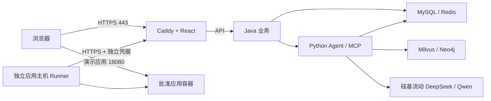

# 云端完整部署准备与资源清单

日期：2026-11-06。范围：完整云端演示及一个真实应用租约的交付准备；支付只使用支付宝沙箱，不开通正式扣款或自动云采购。

后续变更：用户明确选择现有2GB Linux ECS同机受限演示，已完成实际部署，见[ECS Linux单机受限演示验收](ECS-Linux单机受限演示-部署验收.md)。本文两台主机建议和全量依赖部署包继续作为完整模式准备资料，不代表当前已部署Milvus/Neo4j。

## 当前状态

已有 Windows ECS 仅部署平台前端，地址为 http://121.43.82.247/ 。本次检查为 2 核、2 GB 内存，可用内存约 535 MB、磁盘约 24 GB。它保持原系统和 IIS 站点，不作为完整控制面或 Linux 应用池。

本次新增 Linux 控制面 Compose、HTTPS 网关、独立应用主机 Runner 的 systemd 服务、静态构建与源码白名单打包、私有配置初始化及前置检查。Java 浏览器来源白名单已支持正式域名并有精确匹配测试。

**尚未发生：购买资源、部署云端后端、签发公网证书、云端真实应用纳管、云端支付及退租验收。** 用户已明确本轮先做准备和资源清单。

## 需要准备的资源

以下为首轮演示的工程配置建议，不是容量压测结论，也不是供应商报价。

| 资源 | 本轮准备规格 | 用途与约束 |
|---|---|---|
| 控制面 Linux 主机 1 台 | x86_64，建议 4 核、16 GB RAM，80 GB 以上 SSD；部署前至少 40 GiB 空闲 | 运行 React 网关、Java、Python、MySQL、Redis、Milvus、Neo4j。组合部署启动脚本要求至少约 16 GB 内存；较小机器需要拆分数据库服务并调整部署包，不能直接照搬 |
| 应用运行 Linux 主机 1 台 | x86_64，建议 2 核、4 GB RAM，40 GB 以上 SSD | 仅部署批准的 Spring Boot + React 应用和 Runner；一台主机对应一个独占用户租约。平台基础服务不部署在此主机 |
| 网络 | 同地域优先；控制面有公网 HTTPS 入口；应用主机有可访问的公网地址 | Runner 出站访问控制面 443；两台均需出站访问镜像/软件源，控制面需访问硅基流动和支付宝沙箱；现有 Windows 主机无需新增端口 |
| 平台域名 | 1 个已持有且可修改 DNS 的域名/子域名 | A 记录指向控制面公网 IP。没有 IPv6 时不添加错误 AAAA 记录；HTTPS 签发后才连接用户登录流程 |
| 证书联系邮箱 | 1 个有效邮箱 | Caddy 证书联系配置。实际签发与续期需要域名、网络及证书机构可达 |
| 外部服务凭据 | 现有硅基流动 Key；现有支付宝沙箱配置与 RSA2 文件 | 在目标机本地配置，不放到聊天、Git 或公共压缩包里。不要把正式支付宝密钥填进沙箱部署 |
| 运维访问 | 主机 IP、SSH 用户、私钥或已启用的云助手，以及实例 ID | 远程管理只允许管理员来源 IP。后续确认目标身份后再上传配置；不把账号密码写入需求文档 |
| 租约资料 | 应用主机实际采购期限、已确认成本、地域及可用区 | 包年包月期限必须覆盖租期和宽限期。按量付费不能拿云 API 的 2099 日期当已预付多年，需要另定实际可保障期限 |

Milvus 自身的硬件前提请参阅[官方要求](https://milvus.io/docs/v2.6.x/prerequisite-docker.md)。这里提高组合主机内存预算，是因为还要运行 Java、Python 和多种数据库，不能把 Milvus 最低配置当作全项目配置。

## 目标分工



MySQL、Redis、Milvus、Neo4j、Java、Python 均不映射宿主公网端口。网关只转发业务 API 和有独立认证的 `/internal/runner/*`；`/internal/tools/*` 及 Agent 文档入口不对外开放。

## 端口清单

| 主机 | 入站端口 | 来源 |
|---|---|---|
| 控制面 | TCP 80、443 | 公网；80 用于 HTTPS 跳转与证书挑战 |
| 控制面 | TCP 22 | 管理员固定来源 IP，或改用云助手 |
| 应用主机 | TCP 18080 | 首轮演示访问者；这里只放非敏感样例应用，不发送平台密码或令牌 |
| 应用主机 | TCP 22 | 管理员固定来源 IP，或改用云助手 |

应用的 18080 地址沿用当前 Runner 的 HTTP 样例交付能力；它不是平台登录入口。若用户应用需要传递凭据或正式开放，须为应用另加域名/HTTPS，并修改 Runner 返回的访问地址后验收，不能把它称为全站 HTTPS 已完成。

## 本地构建部署包

项目根目录执行：

```powershell
.\.venv\Scripts\python.exe deploy\build_cloud_bundle.py
```

如果 Java 和 React 刚完成构建验证，可使用 `--skip-build`。批准应用镜像构建目录来自现有 `deploy/build_sample_application.py`。

结果为 `runtime/cloud-releases/<版本>.tar.gz`，含控制面、应用主机两个目录和 SHA-256 文件清单。只打包必要 Python 源码、MCP 配置、原有示例知识文档、Java JAR、React 产物与批准样例构建上下文。不打包 `.env`、本地数据库、历史订单、管理员密码、云密钥、Runner 令牌或本地加密主密钥。

`contains_credentials: false` 是打包策略声明，仍需在上传前验证归档清单。Python 依赖基于本地锁文件排除 Windows 专属 `pywin32`；其 Linux 安装和镜像构建必须在目标机实测。镜像版本为准备版本，正式发布前应固定经过验证的镜像摘要。

## 控制面部署步骤

在专用 Linux 主机安装 Docker Engine 和 Compose 插件（依据[Docker 官方安装文档](https://docs.docker.com/engine/install/ubuntu/)），上传部署包并进入 `control`：

```sh
python3 prepare_config.py --domain <平台域名> --email <证书邮箱>
# 本地编辑 .env，填入 SILICONFLOW_API_KEY 和支付宝沙箱 App ID / 商户 ID。
# 本地放置 secrets/alipay-private.pem 和 secrets/alipay-public.pem，不在命令行中粘贴密钥。
python3 preflight.py
sudo sh start.sh
docker compose ps
```

初始化器生成新的数据库密码、内部服务令牌、管理员密码和 32 字节应用加密密钥，不复制开发环境凭据。已有 `.env` 或主密钥时拒绝重新生成，避免损坏既有密文。

启动使用 `PLATFORM_DEMO=false`：不会自动上架开发环境的模拟库存。管理员从私有 `.env` 取得初始账号，在后台创建平台应用商品和 `POOL` SKU，完成主机纳管后再上架。支付宝沙箱凭据就绪后，仍需在渠道后台明确切换 `ALIPAY_SANDBOX` 为 `SANDBOX`，验证创建支付单及查询；正式渠道没有启用。

Caddy 根据域名申请证书并代理流式 API，参考[官方 HTTPS](https://caddyserver.com/docs/automatic-https)和[反向代理说明](https://caddyserver.com/docs/caddyfile/directives/reverse_proxy)。DNS、证书和访问结果以实际验证为准。

## 应用主机纳管步骤

1. 在独立应用 Linux 主机安装 Docker Engine、Python 3，确认 x86_64。不要将控制面主机同时登记成出租资产。
2. 上传 `worker` 目录，构建批准镜像：

   ```sh
   docker build -t cloudagent-demo-backend:1 backend
   docker build -t cloudagent-demo-frontend:1 frontend
   ```

3. 平台后台登记真实应用主机：选择 `POOL` SKU、填写实际实例 ID、地址、采购覆盖期限和成本，模式为 `ALIYUN`。不得把 2099 哨兵日期或未承诺的续费当作真实采购期限。
4. 管理员生成一次性注册令牌，复制 `bootstrap.example.json` 为 `bootstrap.json`，填入 HTTPS 平台地址、令牌、应用主机地址和应用端口。不启用 `allow_local_http`。令牌有效期只有 10 分钟，临近安装时再生成。
5. 执行 `sudo sh install_runner.sh`。独立 systemd 服务保存凭据与 SQLite 回执；已有 Runner 时安装器拒绝覆盖。Docker 访问等同高权限，因此此账号只用于这台专用应用主机，不能在控制面共用。
6. 后台检查 Runner 能力、镜像摘要、心跳和 `IDLE`。只有真实可用主机才形成库存，不手工填虚假容量。

Runner 日志：`journalctl -u cloudagent-runner -f`。凭据和回执在 `/var/lib/cloudagent-runner`，升级时必须保留。

## 云端必须实际通过的验收

这些是待执行验收，不是当前已通过结果：

- 从外部网络通过 HTTPS 打开平台，检查证书、Secure Cookie、登录、刷新、退出和来源白名单；近似域名请求返回 403。
- Java 到 Python、MCP 到 Java 的认证链路正常；真实 DeepSeek 回答和 Qwen 检索可用；流式聊天完成。知识文档按发布审批流程导入云端，不复制开发环境草稿或旧向量。
- 使用新测试用户下单，以支付宝沙箱完成付款并由渠道查询/验签结果确认，不能用数据库改状态冒充支付。
- 真实应用主机分配到该用户，二次购买不能超卖；用户核对并确认部署计划后应用实际可访问。
- 验证重启、回滚、日志；另一用户无法查看或操作该项目，模型不能自己确认执行。
- 退租后清理原 allocation 容器/网络，成功后回到 IDLE；旧用户及旧计划不能影响下一租户。清理失败保持隔离。
- 重启服务或主机后验证数据库、密钥、Runner 回执仍可用。首次云端数据库为独立新库，不直接覆盖本地数据。

## 恢复与交付边界

本轮保留原 Windows 前端预览和本地运行环境。新云端环境使用独立命名卷，避免覆盖本地数据。不得为排障执行 `docker compose down -v` 或 Docker 全局清理。

需要回退应用版本时保留原镜像、配置和数据，按已确认计划操作。恢复数据库时需同时持有正确的应用加密主密钥；新建主密钥不能解密旧数据库。

只有目标机镜像构建、HTTPS、沙箱支付、真实租约、部署及退租清理全部取得证据，才可把第 1、2 步标记为完成。

## 本轮准备验收结果

- Java 构建及 49 项测试通过，包括三层架构约束、新公网来源白名单及近似域名拒绝测试。
- 部署包的 3 项自动检查通过：源码白名单、只有网关映射端口、初始化配置不覆盖旧密钥。
- 在现有 Linux VM 上使用 Docker Compose 实际解析配置成功；两个安装/启动脚本通过 `sh -n`。
- 使用实际 Caddy 2.10.2 镜像执行配置验证成功；验证容器禁用网络，没有尝试为示例域名签发证书。
- 归档文件 SHA-256 清单逐项核对通过；未包含 `.env`、私钥文件、本地数据库，且没有检出当前本地环境中已配置的长密钥值。
- Linux 控制面镜像构建、全套数据库冷启动及云端业务流程尚未执行；现有 4 GB 开发 VM 不满足组合控制面准备规格，不为测试挤占其现有 Milvus 和应用。
